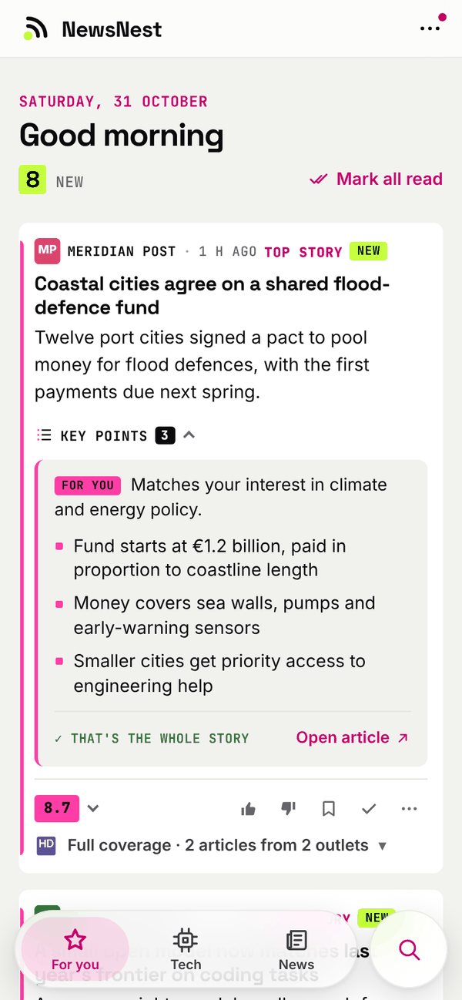
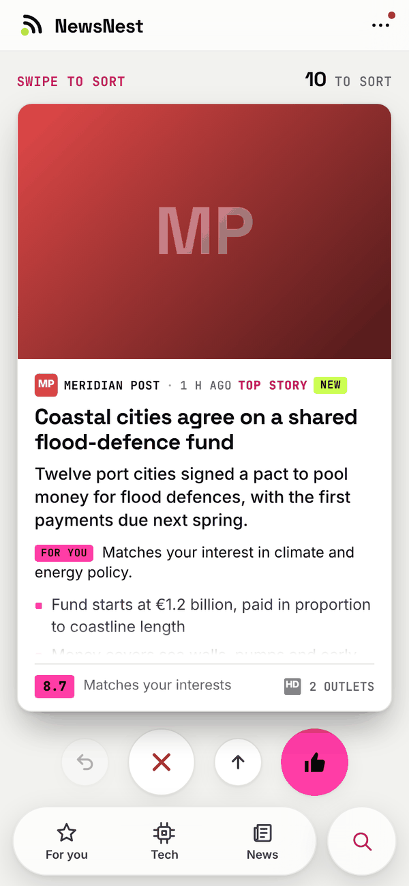
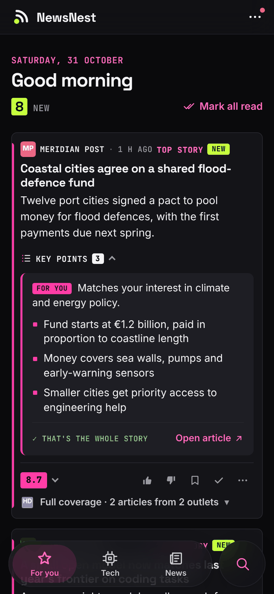
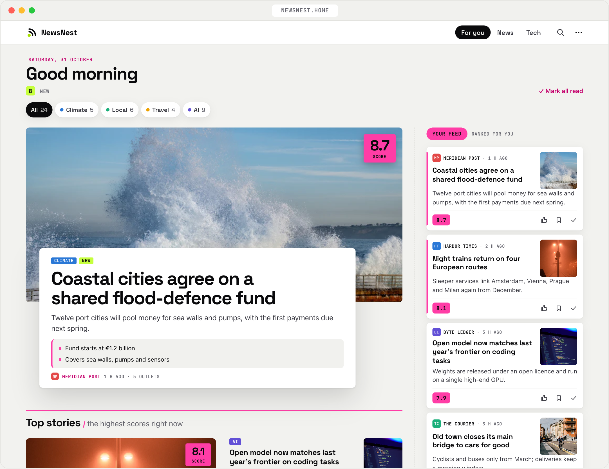

<div align="center">


# NewsNest

**A self-hosted news feed that learns what you care about.**

NewsNest gathers your RSS feeds into one calm stream, folds the same story from different outlets
into a single card, and uses Claude (or a model of your choice, even a local one) to rank and summarise
what matters to you.

[](https://github.com/Lucifix/newsnest/releases/latest)


[](https://hub.docker.com/r/lucifix/newsnest)

[](https://github.com/Lucifix/newsnest/actions/workflows/docker-publish.yml)


[Website](https://lucifix.github.io/newsnest/) · [Features](#features) · [Quick start](#quick-start) · [How it works](#how-it-works) · [Configuration](#configuration) · [Development](#development)

<br>

<table>
  <tr>
    <td align="center" width="33%"></td>
    <td align="center" width="33%"></td>
    <td align="center" width="33%"></td>
  </tr>
  <tr>
    <td align="center"><sub>Feed, ranked for you</sub></td>
    <td align="center"><sub>Swipe to sort</sub></td>
    <td align="center"><sub>Dark mode, automatically</sub></td>
  </tr>
  <tr>
    <td align="center" colspan="3"></td>
  </tr>
  <tr>
    <td align="center" colspan="3"><sub>A front page on bigger screens</sub></td>
  </tr>
</table>

<sub>Outlets and headlines are made up. Photos from <a href="https://unsplash.com">Unsplash</a> by
<a href="https://unsplash.com/@jbl12761">James Lee</a>, <a href="https://unsplash.com/@amoltyagi2">Amol Tyagi</a>,
<a href="https://unsplash.com/@gabiontheroad">Gabriella Clare Marino</a> and <a href="https://unsplash.com/@afgprogrammer">Mohammad Rahmani</a>.</sub>

</div>

## Why NewsNest?

Checking a dozen news sites every day is slow, and most of what you see isn't for you. Algorithmic
feeds fix that by learning what keeps you scrolling, which is not the same as what you want to read.

NewsNest is the opposite deal. **You choose the sources, you write down what interests you, and you can
see why every story ranks where it does.** It runs on your own machine, keeps everything in one SQLite
file, and talks to the Anthropic API with your own key, or to any OpenAI-compatible API, including a
local model in Ollama.

## Features

- 📰 **Your own sources.** Any RSS or Atom feed, plus GitHub release feeds for software you run. Import an
  OPML file, or try new feeds on probation: they only earn a place in your feed once you read them.
- 🧠 **Ranked for you.** The AI scores each story on topic, importance and personal fit against an
  interests file that you write yourself or have drafted from a few ratings.
- 🧩 **One story, not five.** Coverage of the same event by several outlets is grouped into one card,
  and wide coverage lifts a story up.
- ✨ **Key points on demand.** A one-line lede, a few bullets, a "why this matters to you" line, and a
  hint whether the full article is worth your time.
- 👍 **It learns from you.** Likes, dislikes and opens shift what you see. Pick *more about* or *less from*
  for an outlet or topic, and review the weekly suggestions for your interests before they apply.
- 🔄 **Follows your changing interests on its own.** Topics you've been reading lately, even just the headline
  and summary, move up; ones you stopped reading move down, never out, and come back when you do. No
  questions asked. Profile shows what it noticed, and every count behind it (Profile → What it's based on);
  Settings → General turns it off.
- 🔎 **No black box.** Calibration mode shows every story with its scores and reasons, and
  *Missed this* lets you paste a link the feed should have shown you.
- 🃏 **Swipe to sort.** A one-thumb deck of the stories NewsNest is least sure about, so a few minutes of rating teaches it the most.
- 🖥️ **A front page on bigger screens.** On a laptop or desktop the home page becomes a front page: your
  top story large with its score, then Top stories and a block for each category, with your ranked feed
  beside it. *More stories* opens the rest of the feed as one column.
- 💸 **A hard spending cap.** AI calls stop for the day when your budget is reached (default $0.50).
  Without an API key everything still works, and stories are shown newest first.
- 📱 **Installable and private.** A mobile-first web app with light and dark themes that installs to
  your home screen. Password-protected, with a one-click database backup.
- 🩺 **Knows when a feed breaks.** A status page and a `/health` endpoint report sources that fail or
  go silent.

<details>
<summary>And more</summary>

- Keyword **watches** that always surface a topic, plus mute and must-show keyword filters
- Full-text **search**, **saved** stories, a **read** history and a day-by-day **archive**
- Per-source daily caps, so a firehose feed can't drown out everything else
- Summaries in the language of your choice

</details>

## Quick start

You need [Docker](https://docs.docker.com/get-docker/) with Compose, and, for the AI features, an
[Anthropic API key](https://console.anthropic.com/) (or another provider, see
[Choosing an AI provider](#choosing-an-ai-provider)). Pull the published image (no clone needed, and the
one to use for a Portainer stack), or build from source.

### Option A: pull the published image

Multi-arch (`linux/amd64` + `linux/arm64`, so a Raspberry Pi or an ARM NAS works too):

- GHCR: `ghcr.io/lucifix/newsnest`
- Docker Hub: `docker.io/lucifix/newsnest`

Paste this into Portainer (**Stacks → Add stack → Web editor**) or save it as `docker-compose.yml`
anywhere. Only the password needs filling in:

```yaml
services:
  newsnest:
    image: ghcr.io/lucifix/newsnest:latest
    container_name: newsnest
    restart: unless-stopped
    ports:
      - 3095:8080
    environment:
      NEWSNEST_PASSWORD: change-me   # required: with no password the app refuses all access
      ANTHROPIC_API_KEY: ""          # optional: enables ranking and summaries
      TZ: UTC                        # your time zone, e.g. Europe/Ljubljana
    volumes:
      - newsnest-config:/config
      - newsnest-data:/data

volumes:
  newsnest-config:
  newsnest-data:
```

For the full file, with host folders you can open and edit instead of Docker volumes, use
[`docker-compose.yml`](docker-compose.yml) from this repo:

```bash
mkdir newsnest && cd newsnest
curl -fsSLO https://raw.githubusercontent.com/Lucifix/newsnest/main/docker-compose.yml
curl -fsSL https://raw.githubusercontent.com/Lucifix/newsnest/main/.env.example -o .env
mkdir -p config data     # so Docker doesn't create them as root
# edit .env: set NEWSNEST_PASSWORD, and ANTHROPIC_API_KEY for AI
docker compose up -d
```

**Update:** `docker compose pull && docker compose up -d`. Set `NEWSNEST_IMAGE_TAG` in `.env` to pin a
release such as `0.7.1`; the default is `latest`.

### Option B: build from source

```bash
git clone https://github.com/Lucifix/newsnest.git && cd newsnest
cp .env.example .env     # set NEWSNEST_PASSWORD, and ANTHROPIC_API_KEY for AI
mkdir -p config data     # so Docker doesn't create them as root
docker compose up -d --build
```

**Update:** `git pull && docker compose up -d --build`

### First run

Open <http://localhost:3095>, log in with your password, and tap **Set up my profile**:

1. **Say where you live.** Your country and city tell the AI whose news is "big", and your time zone is
   picked up from the browser.
2. **Add local news.** NewsNest offers the local pack for your country (Australia, Austria, Canada,
   Croatia, France, Germany, Italy, Slovenia, the United Kingdom and the United States so far), or add your
   own feeds under Local in **Settings → Feeds**.
3. **Rate about 30 headlines**, and the AI drafts your interests from them.

On first start NewsNest copies a starter [`config.yaml`](config.example/config.yaml) into `config/`, with
international news and tech feeds and no local ones. Change the feeds in **Settings → Feeds**, or edit
the file. It is re-read on every run, so there is nothing to restart.

> [!NOTE]
> The login is a single shared password over plain HTTP, which is fine on your home network. If you
> expose NewsNest to the internet, put it behind an HTTPS reverse proxy.

## How it works

NewsNest collects headlines from your feeds, groups the same story from different outlets into one card,
and has an AI score each one against your interests. The best rise to the top of your feed, which keeps
learning from how you read it.

**The full story:** [How NewsNest works](docs/how-it-works.md) follows one real headline all the way to
your feed.

**What leaves your server:** headlines and snippets, and for key points the article text, go to the
Anthropic API using your key (or to the provider you configured; with a local model in Ollama, nothing
leaves your network). Your feed list, ratings and database stay on your machine, and NewsNest itself sends
no telemetry.

**Known limits:** stories are grouped by their headlines, so two different stories are sometimes merged
(both headlines stay visible on the card). Most feeds only hold about a day of news, so the first start
can only fetch what the feeds still have (at most 3 days, `max_item_age_days`).

### Choosing an AI provider

Claude through the Anthropic API is the default and needs nothing beyond `ANTHROPIC_API_KEY`. To use
something else, add an `ai:` section to `config.yaml` and set `scoring.model` and `scoring.profile_model`
to models that provider serves. `provider: openai` speaks the OpenAI API, which OpenAI, OpenRouter, Groq,
DeepSeek, Gemini, Ollama, LM Studio and vLLM all offer.

```yaml
# Ollama in the same stack (or http://host.docker.internal:11434/v1 for Ollama on this machine)
ai:
  provider: openai
  base_url: http://ollama:11434/v1
  timeout_seconds: 600
  prices: {"*": [0, 0]}      # local: free, so the budget never stops it
  profile:                   # optional: keep Claude for the rare profile jobs
    provider: anthropic
scoring:
  model: qwen3:14b
  profile_model: claude-opus-5-5
```

| Provider | `base_url` | Key |
| --- | --- | --- |
| OpenAI | *(empty)* | `OPENAI_API_KEY` |
| OpenRouter | `https://openrouter.ai/api/v1` | `api_key_env: OPENROUTER_API_KEY` (add it to the compose environment) |
| Ollama / LM Studio | `http://<host>:11434/v1` / `http://<host>:1234/v1` | none |

With a `base_url` the key is optional, since local servers need none, unless `api_key_env` names one: then a
missing variable shows as "… is not set" on the status page instead of a 401 from the API.

Things to know before switching:

- **Quality.** Scoring, grouping by event and the profile draft were tuned on Claude. Small local models
  (8B and below) rank noticeably worse and sometimes skip stories; 14B and up do reasonably. Keep a strong
  model for `profile_model`, through `ai.profile` if needed.
- **Prices.** Claude models are priced built in. Any other model counts at Claude Opus rates until you
  set its price under `ai.prices` (USD per million tokens, `[input, output]`), so the daily budget runs out
  early. The status page warns when a price is missing.
- **Ollama on the host** listens on `127.0.0.1` only: start it with `OLLAMA_HOST=0.0.0.0` so the container
  can reach it. Raise its context window (`OLLAMA_CONTEXT_LENGTH=16384` or more), or the scoring prompt is
  cut off silently. On a CPU, raise `timeout_seconds`.
- **Structured output.** NewsNest asks for a strict JSON schema. A server that rejects it needs
  `json_mode: json`. Reasoning models get `scoring.effort` only with `send_effort: true`.
- **Going back** to an older image: those don't know the `ai:` section. Remove it, or restore
  `config.yaml.bak`.

## Configuration

Everything lives in the `config/` folder, which is re-read on every run:

| File | Purpose |
| --- | --- |
| `config.yaml` | Feeds, GitHub repos, watches, schedules, thresholds, models and the spending cap. Every option is explained in [`config.example/config.yaml`](config.example/config.yaml). |
| `interests.md` | What you care about and what to skip. Written on the Profile page, or by hand. |
| `seed_examples.md` | About 20 example headlines marked `+` (want) or `-` (don't want). |

Edits made in the Settings pages are written back to `config.yaml`, comments included.

> [!TIP]
> The example config comes with international feeds, no region and the time zone `UTC`. Set where you
> live in **Settings → General** (country, city, time zone), and NewsNest offers your country's local pack.

**Sections.** Every feed belongs to one section, and the sections are the tabs along the bottom of the
feed. A new install starts with Local, World and Tech. In **Settings → Feeds → Sections** you can rename
them, add your own (Sports, Science, Cinema…), reorder them, and remove one (its feeds and stories move
to a section you pick). Local and World are built in: they can be renamed but not removed, and share the
News tab. A section is a tab once it has a feed; at most four can be tabs, and any further section
shows as a chip under **For you**. The list is the `sections:` key in `config.yaml`. A `config.yaml`
from before sections were editable has none and keeps the old four (Tech, Local, World, Lifestyle) until
you change them, so nothing needs migrating and the database is untouched.

> [!NOTE]
> Once you edit sections, `config.yaml` has a `sections:` list that older NewsNest versions don't
> understand. To go back to an older image, restore the `config.yaml.bak` made by the last edit.

<details>
<summary>Environment variables</summary>

Set these in `.env` (see [`.env.example`](.env.example)).

| Variable | Default | Purpose |
| --- | --- | --- |
| `NEWSNEST_PASSWORD` | – | **Required.** Password for the web UI. With none set, access is refused. |
| `ANTHROPIC_API_KEY` | – | Turns on scoring, key points and the weekly suggestions with Claude. |
| `OPENAI_API_KEY` | – | Key for `ai.provider: openai` (OpenAI and other hosted APIs). Local servers need none. |
| `TZ` | `UTC` | Container time zone (logs). The app itself uses `timezone` from `config.yaml`. |
| `NEWSNEST_PORT` | `3095` | Port the web UI is published on. |
| `NEWSNEST_CONFIG_PATH` | `/opt/newsnest/config` | Host folder for `config.yaml` and the profile files. |
| `NEWSNEST_DATA_PATH` | `/opt/newsnest/data` | Host folder for the database. |
| `PUID` / `PGID` | `1000` | User and group the container runs as. |
| `NEWSNEST_LOG_LEVEL` | `INFO` | Log level. |
| `NEWSNEST_SCHEDULER` | `on` | Set to `off` to disable background fetching (for development). |

`.env.example` sets the two paths to `./config` and `./data`.

</details>

<details>
<summary>Backup and restore</summary>

**Backup:** open **Settings → Install, backup & log out → Download database backup**. It gives you a
single consistent `.db` file with all stories, ratings and history, and it is safe to take while the app
is running. Copy the `config/` folder too: it holds your feeds and interests, which the download does
not include.

**Restore:** stop the container, put the backup in your data folder as `newsnest.db`, and start it again.
With Docker volumes (the Option A snippet), copy it in while the container is stopped:
`docker cp backup.db newsnest:/data/newsnest.db`.

**Automatic backups before upgrades:** when a new release changes the database layout, NewsNest first
copies the database to `backups/` in your data folder (for example
`backups/newsnest-20261107-093000-v16.db`, where `v16` is the layout it had). It keeps the three newest
copies. To undo an upgrade, stop the container, put that copy back as `newsnest.db`, and start the
previous release. If you start an older release on a database a newer one has already upgraded, NewsNest
refuses to start and says so in the log, rather than running on a layout it doesn't know.

</details>

<details>
<summary>Deploy with Portainer</summary>

1. Create the host folders, owned by the container user:
   ```bash
   sudo mkdir -p /opt/newsnest/config /opt/newsnest/data
   sudo chown -R 1000:1000 /opt/newsnest
   ```
2. **Stacks → Add stack → Repository**: use this repository's URL, reference `refs/heads/main`, compose
   path `docker-compose.yml`.
3. Add the environment variables `NEWSNEST_PASSWORD` and `ANTHROPIC_API_KEY`.
4. Deploy. Portainer pulls the published image from `ghcr.io`; nothing is built on your server.
5. Check `http://<server>:3095/health`, then open `http://<server>:3095/`.

To update, choose **Pull and redeploy** on the stack, with *Re-pull image* turned on. The config and
database live in `/opt/newsnest` and survive redeploys.

</details>

<details>
<summary>Install it as an app on your phone</summary>

NewsNest is a progressive web app: it gets a home-screen icon, opens full screen, and keeps your most
recent pages available offline. Browsers only offer to install over **HTTPS**, so open it through an
https address, for example one served by a reverse proxy, rather than `http://<server>:3095`.

- **Android (Chrome):** menu → *Install app*, or **Settings → Install** inside NewsNest.
- **iPhone (Safari):** Share → *Add to Home Screen*.

</details>

## Development

```bash
python3 -m venv .venv && .venv/bin/pip install -r requirements.txt pytest
.venv/bin/python -m pytest                 # run the tests
NEWSNEST_PASSWORD=dev NEWSNEST_SCHEDULER=off .venv/bin/python -m newsnest   # the app on :8080
```

The first run copies `config.example/` to `./config/` (git-ignored). Two helpers are useful when
adding or debugging sources:

```bash
.venv/bin/python -m newsnest.spike --source <feed-id>    # fetch one source and print parsed samples
.venv/bin/python -m newsnest.runner --no-ai              # one fetch-and-store tick, without AI
```

There is also a dev container with its own project name, port `3096` and the local `./config` and
`./data` folders:

```bash
docker compose -f docker-compose.yml -f docker-compose.dev.yml up -d --build
```

<details>
<summary>Project layout</summary>

```
newsnest/
  web.py            FastAPI app: pages, settings, login, JSON endpoints
  runner.py         the 60-second loop: fetch due sources, then the AI steps
  fetchers/         RSS/Atom and GitHub-releases fetchers
  pipeline.py       store items, de-duplicate by URL, record source health
  grouping.py       group the same story across outlets
  scoring.py        AI scoring and the final score
  summaries.py      key points, fetched from the article text
  feed.py           ranking and the home feed
  profile*.py       interests, drafting, and the weekly suggestions
  discovery.py      OPML import and sources on probation
  db.py             SQLite schema and migrations
  templates/        Jinja templates      static/  CSS, JS, fonts, icons
config.example/     starter config, copied to config/ on first start
tests/              pytest suite
```

</details>

Planned work is tracked in [GitHub issues](https://github.com/Lucifix/newsnest/issues).

## Contributing

Bug reports, ideas and pull requests are welcome. Found a bug? Settings → *About & report a bug* in the
app opens a new issue with your version filled in. Please open an issue first for anything big. Run
`python -m pytest` and `ruff check .` before you send a PR (CI runs the linter on every PR), and add
a test for what you change.

**A local news pack for your country** is an easy first PR: add a `LocalPack` to `LOCAL_PACKS` in
[`newsnest/packs.py`](newsnest/packs.py) with 8 to 10 national outlets across the spectrum, each checked
with `newsnest.discovery.check_feed` (https, working, posting in the last two weeks).

## License

[MIT](LICENSE), except the bundled fonts in [`newsnest/static/fonts/`](newsnest/static/fonts/):
[JetBrains Mono](https://github.com/JetBrains/JetBrainsMono) and
[Space Grotesk](https://github.com/floriankarsten/space-grotesk) are licensed under the
[SIL Open Font License 1.1](https://openfontlicense.org); their license files sit next to the fonts.
