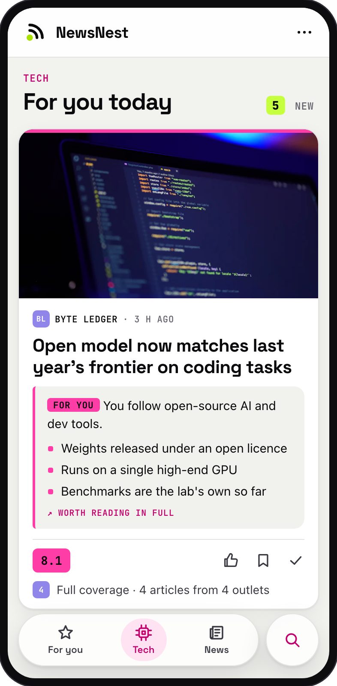
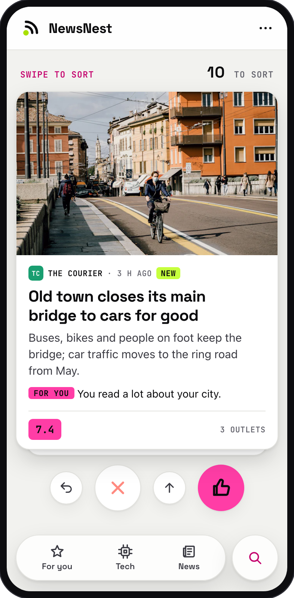
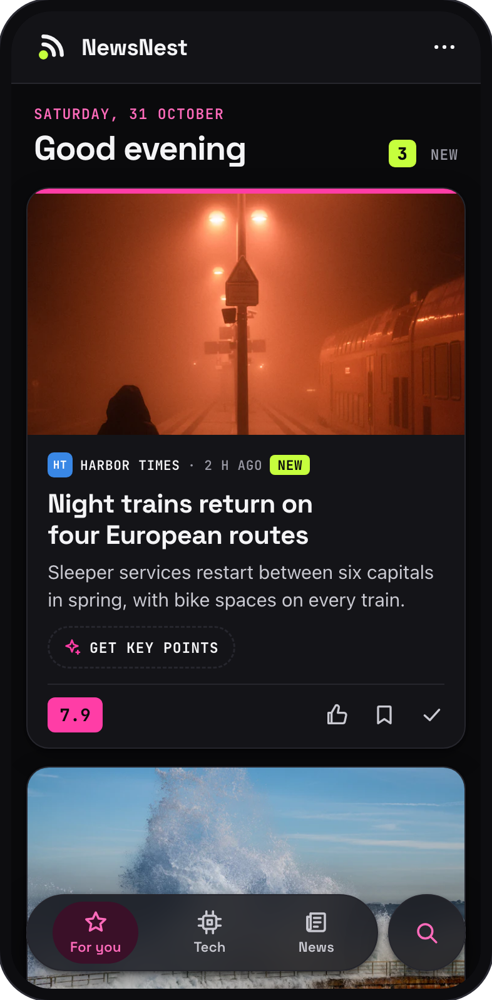
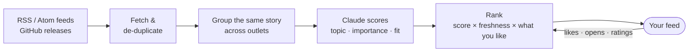

<div align="center">


# NewsNest

**A self-hosted news feed that learns what you care about.**

NewsNest gathers your RSS feeds into one calm stream, folds the same story from different outlets
into a single card, and uses Claude to rank and summarise what matters to you.

-orange)


[Website](https://lucifix.github.io/newsnest/) · [Features](#features) · [Quick start](#quick-start) · [How it works](#how-it-works) · [Configuration](#configuration) · [Development](#development)

<br>

<table>
  <tr>
    <td align="center" width="33%"></td>
    <td align="center" width="33%"></td>
    <td align="center" width="33%"></td>
  </tr>
  <tr>
    <td align="center"><sub>Feed, ranked for you</sub></td>
    <td align="center"><sub>Swipe to sort</sub></td>
    <td align="center"><sub>Dark mode, automatically</sub></td>
  </tr>
</table>

<sub>Outlets and headlines are made up. Photos from <a href="https://unsplash.com">Unsplash</a> by
<a href="https://unsplash.com/@afgprogrammer">Mohammad Rahmani</a>, <a href="https://unsplash.com/@gabiontheroad">Gabriella Clare Marino</a>
and <a href="https://unsplash.com/@amoltyagi2">Amol Tyagi</a>.</sub>

</div>

## Why NewsNest?

Checking a dozen news sites every day is slow, and most of what you see isn't for you. Algorithmic
feeds fix that by learning what keeps you scrolling, which is not the same as what you want to read.

NewsNest is the opposite deal. **You choose the sources, you write down what interests you, and you can
see why every story ranks where it does.** It runs on your own machine, keeps everything in one SQLite
file, and talks to the Anthropic API with your own key.

## Features

- 📰 **Your own sources.** Any RSS or Atom feed, plus GitHub release feeds for software you run. Import an
  OPML file, or try new feeds on probation: they only earn a place in your feed once you read them.
- 🧠 **Ranked for you.** Claude scores each story on topic, importance and personal fit against an
  interests file that you write yourself or have drafted from a few ratings.
- 🧩 **One story, not five.** Coverage of the same event by several outlets is grouped into one card,
  and wide coverage lifts a story up.
- ✨ **Key points on demand.** A one-line lede, a few bullets, a "why this matters to you" line, and a
  hint whether the full article is worth your time.
- 👍 **It learns from you.** Likes, dislikes and opens shift what you see. Pick *more about* or *less from*
  for an outlet or topic, and review the weekly suggestions for your interests before they apply.
- 🔎 **No black box.** Calibration mode shows every story with its scores and reasons, and
  *Missed this* lets you paste a link the feed should have shown you.
- 🃏 **Swipe to sort.** A one-thumb deck to rate a backlog in minutes.
- 💸 **A hard spending cap.** AI calls stop for the day when your budget is reached (default $0.50).
  Without an API key everything still works, and stories are shown newest first.
- 📱 **Installable and private.** A mobile-first web app with light and dark themes that installs to
  your home screen. Password-protected, with a one-click database backup.
- 🩺 **Knows when a feed breaks.** A status page and a `/health` endpoint report sources that fail or
  go silent.

<details>
<summary>And more</summary>

- Keyword **watches** that always surface a topic, plus mute and must-show keyword filters
- Full-text **search**, **saved** stories, a **read** history and a day-by-day **archive**
- Per-source daily caps, so a firehose feed can't drown out everything else
- Summaries in the language of your choice

</details>

## Quick start

You need [Docker](https://docs.docker.com/get-docker/) with Compose, and, for the AI features, an
[Anthropic API key](https://console.anthropic.com/).

```bash
git clone https://github.com/Lucifix/newsnest.git
cd newsnest
cp .env.example .env     # set NEWSNEST_PASSWORD, and ANTHROPIC_API_KEY for AI
mkdir -p config data     # so Docker doesn't create them as root
docker compose up -d --build
```

Open <http://localhost:3095>, log in with your password, and tap **Set up my profile**:

1. **Say where you live.** Your country and city tell Claude whose news is "big", and your time zone is
   picked up from the browser.
2. **Add local news.** NewsNest offers the local pack for your country (Slovenia, Germany, the United
   States and the United Kingdom so far), or add your own feeds under Local in **Settings → Feeds**.
3. **Rate about 30 headlines**, and Claude drafts your interests from them.

On first start NewsNest copies a starter [`config.yaml`](config.example/config.yaml) into `config/`, with
international news and tech feeds and no local ones. Change the feeds in **Settings → Feeds**, or edit
the file. It is re-read on every run, so there is nothing to restart.

> [!NOTE]
> The login is a single shared password over plain HTTP, which is fine on your home network. If you
> expose NewsNest to the internet, put it behind an HTTPS reverse proxy.

**Update:**

```bash
git pull && docker compose up -d --build
```

## How it works



A 60-second loop fetches the sources that are due, scores new stories in batches, and writes key points
for the ones above your threshold. Scoring uses a small, cheap model with prompt caching; the rarer jobs
(drafting your profile, the weekly suggestions) use a stronger one. Both are configurable.

**What leaves your server:** headlines and snippets, and for key points the article text, go to the
Anthropic API using your key. Your feed list, ratings and database stay on your machine, and NewsNest
itself sends no telemetry.

## Configuration

Everything lives in the `config/` folder, which is re-read on every run:

| File | Purpose |
| --- | --- |
| `config.yaml` | Feeds, GitHub repos, watches, schedules, thresholds, models and the spending cap. Every option is explained in [`config.example/config.yaml`](config.example/config.yaml). |
| `interests.md` | What you care about and what to skip. Written on the Profile page, or by hand. |
| `seed_examples.md` | About 20 example headlines marked `+` (want) or `-` (don't want). |

Edits made in the Settings pages are written back to `config.yaml`, comments included.

> [!TIP]
> The example config comes with international feeds, no region and the time zone `UTC`. Set where you
> live in **Settings → General** (country, city, time zone), and NewsNest offers your country's local pack.

<details>
<summary>Environment variables</summary>

Set these in `.env` (see [`.env.example`](.env.example)).

| Variable | Default | Purpose |
| --- | --- | --- |
| `NEWSNEST_PASSWORD` | – | **Required.** Password for the web UI. With none set, access is refused. |
| `ANTHROPIC_API_KEY` | – | Turns on scoring, key points and the weekly suggestions. |
| `TZ` | `UTC` | Container time zone (logs). The app itself uses `timezone` from `config.yaml`. |
| `NEWSNEST_PORT` | `3095` | Port the web UI is published on. |
| `NEWSNEST_CONFIG_PATH` | `/opt/newsnest/config` | Host folder for `config.yaml` and the profile files. |
| `NEWSNEST_DATA_PATH` | `/opt/newsnest/data` | Host folder for the database. |
| `PUID` / `PGID` | `1000` | User and group the container runs as. |
| `NEWSNEST_LOG_LEVEL` | `INFO` | Log level. |
| `NEWSNEST_SCHEDULER` | `on` | Set to `off` to disable background fetching (for development). |

`.env.example` sets the two paths to `./config` and `./data`.

</details>

<details>
<summary>Backup and restore</summary>

**Backup:** open **Settings → Install, backup & log out → Download database backup**. It gives you a
single consistent `.db` file with all stories, ratings and history, and it is safe to take while the app
is running. Copy the `config/` folder too: it holds your feeds and interests, which the download does
not include.

**Restore:** stop the container, put the backup in your data folder as `newsnest.db`, and start it again.

</details>

<details>
<summary>Deploy with Portainer</summary>

1. Create the host folders, owned by the container user:
   ```bash
   sudo mkdir -p /opt/newsnest/config /opt/newsnest/data
   sudo chown -R 1000:1000 /opt/newsnest
   ```
2. **Stacks → Add stack → Repository**: use this repository's URL, reference `refs/heads/main`, compose
   path `docker-compose.yml`.
3. Add the environment variables `NEWSNEST_PASSWORD` and `ANTHROPIC_API_KEY`.
4. Deploy. The image is built from the Dockerfile on your server. It is never pulled, so there is no
   registry to log in to.
5. Check `http://<server>:3095/health`, then open `http://<server>:3095/`.

To update, choose **Pull and redeploy** on the stack. The config and database live in `/opt/newsnest`
and survive redeploys.

</details>

<details>
<summary>Install it as an app on your phone</summary>

NewsNest is a progressive web app: it gets a home-screen icon, opens full screen, and keeps your most
recent pages available offline. Browsers only offer to install over **HTTPS**, so open it through an
https address, for example one served by a reverse proxy, rather than `http://<server>:3095`.

- **Android (Chrome):** menu → *Install app*, or **Settings → Install** inside NewsNest.
- **iPhone (Safari):** Share → *Add to Home Screen*.

</details>

## Development

```bash
python3 -m venv .venv && .venv/bin/pip install -r requirements.txt pytest
.venv/bin/python -m pytest                 # run the tests
NEWSNEST_PASSWORD=dev NEWSNEST_SCHEDULER=off .venv/bin/python -m newsnest   # the app on :8080
```

The first run copies `config.example/` to `./config/` (git-ignored). Two helpers are useful when
adding or debugging sources:

```bash
.venv/bin/python -m newsnest.spike --source <feed-id>    # fetch one source and print parsed samples
.venv/bin/python -m newsnest.runner --no-ai              # one fetch-and-store tick, without AI
```

There is also a dev container with its own project name, port `3096` and the local `./config` and
`./data` folders:

```bash
docker compose -f docker-compose.yml -f docker-compose.dev.yml up -d --build
```

<details>
<summary>Project layout</summary>

```
newsnest/
  web.py            FastAPI app: pages, settings, login, JSON endpoints
  runner.py         the 60-second loop: fetch due sources, then the AI steps
  fetchers/         RSS/Atom and GitHub-releases fetchers
  pipeline.py       store items, de-duplicate by URL, record source health
  grouping.py       group the same story across outlets
  scoring.py        AI scoring and the final score
  summaries.py      key points, fetched from the article text
  feed.py           ranking and the home feed
  profile*.py       interests, drafting, and the weekly suggestions
  discovery.py      OPML import and sources on probation
  db.py             SQLite schema and migrations
  templates/        Jinja templates      static/  CSS, JS, fonts, icons
config.example/     starter config, copied to config/ on first start
tests/              pytest suite
```

</details>

Planned work and known limits are tracked in [TODO.md](TODO.md).

## Contributing

Bug reports, ideas and pull requests are welcome. Please open an issue first for anything big. Run
`python -m pytest` before you send a PR, and add a test for what you change.

**A local news pack for your country** is an easy first PR: add a `LocalPack` to `LOCAL_PACKS` in
[`newsnest/packs.py`](newsnest/packs.py) with 8 to 10 national outlets across the spectrum, each checked
with `newsnest.discovery.check_feed` (https, working, posting in the last two weeks).

## License

[MIT](LICENSE), except the bundled fonts in [`newsnest/static/fonts/`](newsnest/static/fonts/):
[JetBrains Mono](https://github.com/JetBrains/JetBrainsMono) and
[Space Grotesk](https://github.com/floriankarsten/space-grotesk) are licensed under the
[SIL Open Font License 1.1](https://openfontlicense.org); their license files sit next to the fonts.
