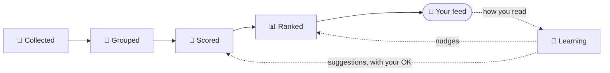

# How NewsNest works

> **The short version:** NewsNest reads hundreds of headlines a day so you don't have to. An AI scores each
> one against *your* interests, the best rise to the top of one calm feed, and the feed quietly learns
> from how you read it. Everything runs on your own server.

This page follows a single headline on its trip through NewsNest: from the moment an outlet publishes it
to the moment it lands in your feed (or doesn't, and why). No code needed to follow along.



---

## 07:12 · A headline is born

On 6 November 2026, Luka Dončić scored 53 points as the Lakers beat Portland 124–118. By morning in Europe,
an outlet publishes: **"Dončić scores 53 as the Lakers beat Portland."** Say three other outlets write
about the same game within the hour, one of them in Slovenian.

Let's follow it.

---

## 📡 1. Collected

NewsNest checks your feeds on a schedule: news every 15 minutes, world news every 20, everything else
every 30. Our headline arrives a few minutes after it was published.

Three quick checks happen before anything else:

- **Seen it already?** Links are compared without tracking junk (`?utm_source=…`), so the same article
  shared twice is stored once.
- **Muted?** If a headline contains one of your *mute* keywords (say, "horoscope"), it stops right here.
  It never reaches the AI and never costs a cent.
- **Must-show?** If it matches one of your *watches* (say, "Dončić"), it's tagged and will be shown no
  matter what it scores. A watch always beats a mute.

## 🧩 2. Grouped

Four outlets, one game. You want **one card**, not four.

NewsNest groups stories two ways:

- **By rare words.** Two headlines sharing "Dončić" and "Portland" probably match; two sharing only
  "government" probably don't. Rare words count for much more than common ones, which works in any
  language without word lists.
- **By event.** When the AI scores a story (next step), it also names the real-world event it's about,
  like `lakers-trail-blazers-game`, reusing labels it already gave to other stories. That catches what word
  matching can't, like the Slovenian article that shares hardly a word with the English ones.

Grouping by headline isn't perfect: two different stories are sometimes merged into one card. When that
happens, both headlines stay visible on the card.

The result is a **card**: one story, all its outlets. Covered by two or more outlets? It earns a small
bonus, because news that several newsrooms chase is usually worth a look.

## 🤖 3. Scored

New headlines wait for a batch of about 15 (or 20 minutes, whichever comes first). Then the AI gets them
along with what it needs to know about you:

- your **interests file**, the plain-text list of what you want and what you'd rather skip,
- a few **example headlines** you marked as wanted or not,
- your **latest 👍 and 👎** (10 of each) and stories you told it it **missed**.

For every headline it answers with:

| | Question | Our game |
|---|---|---|
| **Topic** (0–10) | Does this match what you said you like? | 9: you follow the NBA |
| **Importance** (0–10) | How big is this news, for anyone? | 4: one early-season NBA Cup game |
| **Personal** (0–10) | Would *you* actually want to read it? | 8 |
| **Reason** | One sentence explaining the scores | "Dončić's 53-point night; you follow him." |
| **Category** | One of a fixed list (Sports, Politics, AI, …) | Sports |
| **Interest** | Which line of your interests file it matches | "Luka Dončić and NBA basketball" |
| **Event** | A short name for the real-world event | `lakers-trail-blazers-game` |

All three scores use the same scale: **9–10** you'd be annoyed to miss it, **7–8** you'd likely read
it, **5–6** the headline is enough, **0–4** skip.

They're mixed into one **final score**: 40% topic, 30% importance, 30% personal, plus 1 if several
outlets cover it. Our game: 0.4·9 + 0.3·4 + 0.3·8 + 1 = **8.2**. Comfortably in.

**Below 5, a story stays out of your feed.** Two exceptions: anything matching a watch, and **top
stories** (importance 8 or more). A national emergency gets through even if it's nowhere near your
interests.

**Your levels move that line per interest.** On Profile → *Your interests*, every interest has a level, from
*Much less* to *Much more*. That adds −1 to +1 to the score of each story
the AI matched to the line, before the cut-off, so it changes how many of them get in, not only where
they sit. The score you see on a card already includes it, and its "why" panel says so. A level moves the
whole line: to get fewer watch stories but not fewer gadget stories, split the line in two first.

Stories scoring 6 or more also get **key points**: the AI reads the full article and writes a one-line
summary, a few bullets and whether the full article is worth your time. Any other story gets them when
you tap *Key points*.

> 💸 **Cost control:** a daily budget (default $0.50) caps what the AI may spend. Scoring uses a small,
> cheap model; the rare bigger jobs, like suggesting changes to your interests, use a stronger one.

## 📊 4. Ranked

The feed shows unread stories from the last 36 hours. Each one gets a **rank**:

```text
rank = final score × freshness × a few nudges
```

**Freshness** halves every 24 hours but never drops below half, so a great story from yesterday still
beats a weak one from five minutes ago.

**The nudges:**

| What | Effect |
|---|---|
| ⭐ Top story (importance ≥ 8) | × 1.3 |
| 👁 Matches one of your watches | × 1.15 |
| 🔁 New outlets joined after you read it | × 1.2, and it comes back marked *Updated* |
| 🆕 You haven't seen it yet | × 1.1 |
| 🙈 On screen without being opened | × 0.85 each time; gone after 3 (top stories only sink) |
| 🎚 Your choices in a story's ⋯ menu | the multiplier you set (see below) |
| 🔄 What you've been reading lately | between × 0.6 and × 1.4 (see below) |

Some things keep the feed from becoming an echo chamber:

- **Exploring.** About one card in eight is a story from a category your feed rarely shows, even if it
  scored a bit under 5 (never under 3, so no clickbait). That's how a new interest gets a chance.
- **New sources get a tryout.** A feed you just added gets its best 2 stories in for 14 days, whatever
  they score, so your 👍 and 👎 can decide whether it stays.
- **Revisit.** Once per visit, one story from an interest you've drifted away from shows up early.
  If you read it, that interest comes back.
- **Daily caps.** High-volume outlets can be capped per day, so one prolific site can't flood the feed.

**The feed holds still while you read.** It's ranked once when you arrive and kept that way, so opening a
story and coming back doesn't reshuffle the page. A fresh ranking starts after 45 minutes away, or when
you pull down to refresh.

**Each tab keeps your place.** Switch to another tab and back (or press Back) and you're at the story you
left, with everything you'd scrolled through still loaded. Tap the tab you're on to go to the top, and tap
it again at the top to refresh. Once a fresh ranking starts, every tab starts at the top again.

Every card has a **"why" panel** listing exactly what moved it: *Top story*, *Matches one of your
watches*, *You've been reading about Sports lately*, *Already shown to you 2×*, and so on.

---

## 🧠 5. How it learns from you

NewsNest learns at three speeds. None of them ask you questions.

### Right away: your choices

Every story has a ⋯ menu: **More about** / **Less about** its category, **Less from** its outlet.
Each tap moves that category or outlet by a quarter (× 1.25 or × 0.75), between × 0.2 and × 2. Only you
change these. **Not interested** hides the story and counts as a 👎.

These change the order. To change how many stories of one interest get in at all, set its **level** on the
Profile page (see *Scored* above). A line you set to *Less* is never picked as the *Revisit* story (see *Ranked*).

### Day by day: ratings

Your recent 👍 and 👎 go straight into the AI's next batch, so it learns your taste in examples, not just
in rules. Three ways to give them:

- the 👍 / 👎 on any card,
- the **swipe deck**, which asks about the stories NewsNest is *least sure* about (the ones closest to
  the cutoff), so each swipe teaches it the most,
- **Missed this**: paste a link you found elsewhere and NewsNest shows how it scored it and why it wasn't
  shown, then counts it as a strong 👍.

### Over weeks: what you actually read

Most people read the headline and the summary, and only rarely open the article. You're not alone: in a
[large US survey](https://www.pbs.org/newshour/politics/myth-media-bubble-burst-americans-still-seek-serious-news-study-finds),
about 6 in 10 people said they had read nothing beyond the headlines in the past week. So taps alone
would be a terrible signal. If you never tap Sports but read every Sports headline, Sports *matters to you*.

So NewsNest also notices **what you spend time on**, the way big news apps do:

| How you treated a story | Counts as |
|---|---|
| Scrolled right past | 0 |
| Stayed on screen longer than most of yours (your longest quarter, at least 3 s) | + ½ |
| Opened its key points | + ½ |
| Opened, 👍 or saved it | + 1 each |
| 👎 or *Not interested* | − 1 |

Each interest (a line in your interests file, or a category for stories that match none) and each outlet
gets a tally. Recent reading counts most: something from two weeks ago counts half. The tally is
compared with **your own usual**, so a slow reader and a fast one are treated the same. The result moves
stories at most 40% up or down. Nothing is ever hidden, and top stories and watches are never pushed down.

A few things keep it honest:

- **It waits until it knows you.** Nothing changes until it has recorded at least 14 days and 500 stories
  of your reading. One wild news week shouldn't reshape your feed.
- **Forgetting your phone doesn't count.** Time only counts while you're actively scrolling or tapping
  (within the last 30 seconds) and the screen is on. A story can collect at most a minute per visit.
- **It's open about it.** Profile → *What it's based on* shows every count: stories shown, opened, read
  on screen, and how much more or less each interest and outlet is shown because of it.
- **You can turn it off.** Settings → General → *Follow what I've been reading lately*.

### Once a week: suggestions for your interests file

If you gave at least 10 ratings or choices since the last time, the AI drafts **suggested changes** to
your interests file: a new line here, a reworded one there. Each change is listed separately; untick
what you don't want.

> 🔒 **Your interests file is yours.** NewsNest never changes it on its own. Suggestions only land when
> you accept them.

---

## 🏠 What stays home

| | Where it goes |
|---|---|
| Headlines and snippets | To your AI provider, for scoring |
| Article text | To your AI provider, only for stories that get key points |
| Everything else (your ratings, what you read, how long, your interests) | Stays in the database on your server |
| Telemetry | None. NewsNest doesn't phone home. |

Run a local model (for example with Ollama) and nothing leaves your network at all.

NewsNest also backs up the database before every upgrade that changes it, and you can download it any
time from Settings: see [Backup and restore](install.md#backup-and-restore).

---

## 🎛 You're in charge

| I want to… | Go to |
|---|---|
| Change what I'm interested in | Profile → Your interests (or Advanced → Edit interests as text) |
| Get more or fewer stories of one interest | Profile → Your interests, the level next to it |
| See why a story is in my feed | Its "why" panel |
| See everything my reading changed | Profile → What it's based on |
| Show more or less of an outlet or category | A story's ⋯ menu, or ⋮ on Profile → What it's based on |
| Always see a topic, whatever it scores | Settings → Topics & filters → Watches |
| Never see a word again | Settings → Topics & filters → Mute words |
| See every story with its score | Settings → General → Calibration mode |
| Find the right score cutoff for me | Settings → Calibration |
| Check that everything's running | Settings → Status |

---

## For contributors

Where each step lives in the code:

| Step | Module |
|---|---|
| The every-minute loop | `newsnest/runner.py`, `newsnest/ai_steps.py` |
| Collecting, dedupe, mute and watches | `newsnest/fetchers/`, `newsnest/pipeline.py`, `newsnest/watches.py` |
| Grouping | `newsnest/grouping.py`, `newsnest/events.py`, `newsnest/digest.py` |
| Scoring and key points | `newsnest/scoring.py`, `newsnest/summaries.py` |
| Ranking and the feed | `newsnest/feed.py`, `newsnest/feedsession.py` |
| Following what you read | `newsnest/drift.py` ([design notes](design/interest-drift-plan.md)) |
| Weekly suggestions | `newsnest/profile_ai.py` |

Words used here are defined in [GLOSSARY.md](../GLOSSARY.md).

**Keep this page true.** It describes what NewsNest does, not how the code does it. If your change makes
any sentence here wrong, update it in the same PR.
